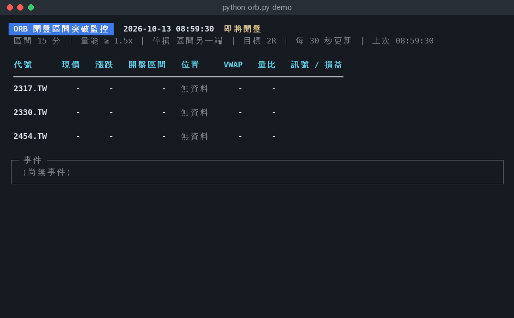

# 📡 orb-radar：台股開盤區間突破（ORB）監控

> 前身為 orb-ntfy。通知不再只限 ntfy，所以改名。

盯著開盤 15 分鐘的高低點，**帶量突破就通知你**（ntfy、Telegram、Discord、Slack、LINE、Email、Pushover 或自訂 Webhook，可以同時開多個）：附進場價、停損、目標價，點一下就開 K 線圖。
收盤後再推一則總結，告訴你每筆訊號最後是達標、停損，還是收盤平倉。



<sub>↑ `python orb.py demo`：用 `data/` 的合成測試資料快轉重播一個早盤（不是真實行情）</sub>

---

## ✨ 功能

- **設定精靈**：`python orb.py init` 一步步選資料來源、填永豐金鑰並測試登入、設定股票、選通知管道並送測試通知
- **三種行情來源 + 假資料**：Yahoo（免費、延遲）、永豐 Shioaji（即時）、假資料（每次隨機一天行情，可以用自己的股票清單和通知管道完整試跑）
- **終端機即時表格**：每檔的現價、漲跌、開盤區間、目前位置、VWAP、量比、訊號與即時損益（紅漲綠跌）
- **多種通知管道**：ntfy、Telegram、Discord、Slack、LINE、Email、Pushover、自訂 Webhook，可同時啟用；內容含進場／停損／目標價與風險報酬，附 Yahoo 股市技術線圖連結；每個管道各自重試，錯誤訊息會遮蔽密鑰
- **收盤總結**：當天每筆訊號的結果與合計 R 值
- **雲端自動執行**：GitHub Actions 每個交易日 08:40 自動啟動、收盤後結束
- **回測**：用跟盤中完全相同的邏輯回測最近 30 天，比較不同參數
- 不會重複通知（每檔每方向每天一次）、開盤前不會誤用昨天的資料、只用已收完的 K 棒判斷

---

## 🚀 快速開始

```bash
git clone https://github.com/jungkang0911/orb-radar.git
cd orb-radar
python3 -m venv .venv && source .venv/bin/activate   # Windows：.venv\Scripts\activate
pip install -r requirements.txt
```

### 1. 先看畫面（不用設定、不用等開盤、不會發通知）

```bash
python orb.py demo
```

### 2. 設定精靈

```bash
python orb.py init
```

依序回答幾個問題，會產生 `config.toml`（一般設定）和 `.env`（密鑰，不會進 git）：

```
① 行情資料來源      yahoo / shioaji / fake / demo
② 永豐 Shioaji 設定  API Key、Secret Key、模擬環境？→ 立即測試登入
③ 監控的股票        2330 2317 6488.two  → 自動補成 2330.TW、2317.TW、6488.TWO
④ 通知管道          可多選：ntfy / Telegram / Discord / Slack / LINE / Email / Pushover / Webhook
                    逐一填金鑰（Telegram 可自動抓 chat id）→ 每個管道送一則測試通知
⑤ 策略參數          直接用預設值，或逐項調整
```

### 3. 用假資料完整試跑

```bash
python orb.py fake
```

用你設定的股票清單，隨機產生一整天的合成行情（帶量突破、假突破、假跌破、盤整），約 2 分鐘快轉跑完一個交易日；**會真的送到你設定的通知管道**，標題前面加上「[假資料]」。沒設定任何管道就只顯示在終端機。

- 想每次都一樣：`python orb.py fake --fake-seed 42`
- 想跟真實時間同步跑：`python orb.py fake --sim-speed 1`

### 4. 檢查與開始監控

```bash
python orb.py check   # 列出目前設定、實際抓一次行情、每個管道送一則測試通知
python orb.py run     # 盤中監控；開盤前啟動會自動等到 09:00
```

命令列參數會覆蓋 `config.toml`，例如 `python orb.py run --vol-factor 2 --notify print`。

---

## 🏦 永豐 Shioaji（即時行情）

1. 到永豐金證券網站申請 API Key 與 Secret Key（只看行情不需要憑證 CA）
2. `pip install shioaji`
3. `python orb.py init` 選 **shioaji**，貼上金鑰，選擇是否用模擬環境，精靈會立刻測試登入
4. `python orb.py check` 確認抓得到 1 分 K

也可以手動設定：`config.toml` 裡 `[data] source = "shioaji"`，`.env` 填 `SHIOAJI_API_KEY`、`SHIOAJI_SECRET_KEY`。

實作細節：每次輪詢用 `api.kbars()` 抓當天 1 分 K、昨收用 snapshot 推回（每天一次）；永豐的 K 棒時間戳如果是「該分鐘結束」（第一根 09:01），程式會自動換成 K 棒開始時間，跟 Yahoo 一致。永豐有行情查詢次數限制，監控很多檔時請拉長 `poll_secs`。

> 這部分已用模擬的 API 物件測過資料轉換，**還沒有用真實帳號連線驗證**；第一次使用請先 `python orb.py check`，有問題歡迎開 issue。

---

## ⚙️ 設定檔

`config.toml`（可以手動從 [`config.example.toml`](config.example.toml) 複製）：

```toml
[data]
source = "yahoo"          # yahoo / shioaji / fake / demo
poll_secs = 30

[symbols]
list = ["2330.TW", "2317.TW", "2454.TW"]   # 或 file = "symbols.txt"

[strategy]
open_mins = 15
vol_factor = 1.5
stop_mode = "range"       # range = 區間另一端；mid = 區間中線
target_r = 2.0

[notify]
channels = ["ntfy", "telegram"]   # 可多選；[] = 只顯示在終端機；不寫 = 自動用 .env 設定齊全的管道
ntfy_server = "https://ntfy.sh"
summary = true
```

`.env`（從 [`.env.example`](.env.example) 複製，**不要 commit**），只填你要用的：

```
NTFY_TOPIC=orb-xxxxxxxx
TELEGRAM_BOT_TOKEN=123456:ABC...
TELEGRAM_CHAT_ID=987654321
SHIOAJI_API_KEY=...
SHIOAJI_SECRET_KEY=...
```

優先順序：命令列參數 ＞ `config.toml` ＞ 預設值。沒有設定股票時會讀 `symbols.txt`。

---

## 🔔 通知長這樣

```
2330.TW 多頭突破 102.14
做多 102.14（09:30）
停損 98.80（-3.3%）
目標 108.83（2R，+6.6%）
ORH 100.70 / ORL 98.80 ｜ VWAP 99.86 ｜ 量 3.3x
```

收盤總結：

```
ORB 收盤總結 10/13
合計 3 筆，-0.68R
2317.TW 空 98.61→98.14 收盤 +0.19R（+0.5%）
2330.TW 多 102.14→102.57 收盤 +0.13R（+0.4%）
2454.TW 多 1009.70→995.30 停損 -1.00R（-1.4%）
```

---

## 📣 通知管道

| 管道 | `.env` 要填 | 怎麼取得 |
|---|---|---|
| `ntfy` | `NTFY_TOPIC`、`NTFY_TOKEN`（選填） | 手機裝 [ntfy App](https://ntfy.sh)，訂閱同一個主題 |
| `telegram` | `TELEGRAM_BOT_TOKEN`、`TELEGRAM_CHAT_ID` | 找 @BotFather `/newbot`；先傳訊息給 bot，設定精靈會自動抓 chat id |
| `discord` | `DISCORD_WEBHOOK_URL` | 頻道設定 → 整合 → Webhook → 複製網址 |
| `slack` | `SLACK_WEBHOOK_URL` | Slack App 開啟 Incoming Webhooks |
| `line` | `LINE_CHANNEL_ACCESS_TOKEN`、`LINE_TO` | LINE Developers 建立 Messaging API channel（LINE Notify 已於 2025-03-31 停止服務；免費方案有每月則數上限） |
| `email` | `SMTP_HOST`、`SMTP_PORT`、`SMTP_USER`、`SMTP_PASSWORD`、`EMAIL_TO` | Gmail：`smtp.gmail.com`、587，密碼用「應用程式密碼」 |
| `pushover` | `PUSHOVER_TOKEN`、`PUSHOVER_USER` | pushover.net 建立 Application |
| `webhook` | `WEBHOOK_URL` | 任何接受 POST JSON 的服務（IFTTT、n8n、Make、自己的伺服器） |

- 選擇方式：`config.toml` 的 `notify.channels`、命令列 `--notify telegram,discord`，或都不寫，自動啟用 `.env` 設定齊全的管道
- 每則訊號會送到所有啟用的管道；某個管道失敗只會重送那個管道，最多 3 次
- Webhook 收到的 JSON：`{"title", "message", "tags", "priority", "click", "sent_at"}`

### 🔐 安全性

- ntfy.sh 上**沒有設定存取控制的主題，任何知道名稱的人都能讀寫**。難猜的名稱只能降低被猜中的機率，不能取代權限控制；需要保護內容就用有設定[存取控制](https://docs.ntfy.sh/config/#access-control)的伺服器並填 `NTFY_TOKEN`，或改用 Telegram 等需要金鑰的管道
- Webhook 網址、Bot Token 都等同密碼，只放在 `.env` 或 GitHub Secrets；程式的錯誤訊息會把它們遮成 `***`
- 不要把帳戶、持股等資訊送進任何第三方通知服務

---

## ☁️ 雲端自動執行（GitHub Actions，免費）

repo 已經附好 [`.github/workflows/orb-monitor.yml`](.github/workflows/orb-monitor.yml)：

1. 到 GitHub repo 的 **Settings → Secrets and variables → Actions**：
   - Secrets：要用的通知管道金鑰，名稱同 `.env.example`（例如 `TELEGRAM_BOT_TOKEN` + `TELEGRAM_CHAT_ID`）；用永豐再加 `SHIOAJI_API_KEY`、`SHIOAJI_SECRET_KEY`
   - Variables（選填）：`ORB_SOURCE` 設成 `yahoo` 或 `shioaji`
2. 股票與策略：commit 一份 `config.toml`（裡面沒有密鑰），或直接編輯 [`symbols.txt`](symbols.txt)
3. 完成。每週一到週五 08:40（台北時間）會自動啟動，收盤推完總結後結束；國定假日沒有行情時會自動判定休市並結束
4. 想手動測試：到 **Actions → ORB 盤中監控 → Run workflow**

> 注意：
> - GitHub 的排程可能延遲幾分鐘到十幾分鐘才啟動，所以設定在 08:40，留了緩衝
> - repo 連續 60 天沒有任何 commit，GitHub 會自動停用排程，需要到 Actions 頁面重新啟用
> - Yahoo 偶爾會限制雲端機房的 IP；如果 log 一直出現抓資料失敗，改在自己電腦上跑

---

## 🧪 回測

**先回測，再相信通知。** 回測用的訊號邏輯跟盤中監控完全相同。

```bash
# Yahoo 最近 30 天 1 分 K（Yahoo 只提供最近 30 天）
python backtest.py --symbols-file symbols.txt

# 比較不同量能門檻
python backtest.py --symbols-file symbols.txt --vol-factor 1.0,1.5,2.0

# 列出每筆交易、存成 CSV
python backtest.py --symbols 2330.TW --trades --out trades.csv

# 用自己的 CSV（欄位：Datetime,Open,High,Low,Close,Volume）
python backtest.py --csv data/*.csv --trades

# 用假資料測試回測流程（結果不代表任何真實績效）
python backtest.py --source fake --symbols 2330.TW,2317.TW --days 20
```

以 `data/` 三檔合成資料為例（只用來示範輸出格式）：

```
量能門檻  筆數 勝率 平均R 累計R 平均報酬  達標  停損  收盤
    1.5x     3  67% -0.23  -0.7   -0.18%     0     1     2
```

出場規則：先碰到停損或目標就出場（同一根 K 棒兩者都碰到，保守算停損），都沒碰到就收盤平倉。**不含手續費、證交稅與滑價**；30 天的樣本也不大，結果請當參考。

---

## 📐 策略規則

1. **開盤區間**：09:00 起前 `--open-mins` 分鐘（預設 15）的最高價 ORH、最低價 ORL，區間完整走完才確定
2. **多頭突破**：1 分 K 收盤價 > ORH，且 ≥ VWAP，且成交量 ≥ 最近 10 根（含當根，不足 10 根時用現有的）平均量 × `--vol-factor`；收盤價剛好等於 ORH 不算突破
3. **空頭跌破**：收盤價 < ORL，且 ≤ VWAP，且量能條件同上
   VWAP 用每根 `(High + Low + Close) / 3` 乘成交量累計加權
4. **停損**：區間另一端（`--stop-mode range`，預設）或區間中線（`mid`）
5. **目標**：進場價 ± 風險 × `--target-r`（預設 2R）
6. 只用**已收完**的 K 棒判斷（進行中那根成交量不完整）

---

## ⚙️ 命令與參數

| 命令 | 說明 |
|---|---|
| `python orb.py init` | 設定精靈 |
| `python orb.py check` | 檢查設定、資料來源、通知管道 |
| `python orb.py demo` | 重播 `data/*.csv`（不發通知） |
| `python orb.py fake` | 假資料完整試跑（會發通知，標題加「[假資料]」） |
| `python orb.py run` | 盤中監控 |
| `python orb.py backtest` | 回測（參數同 `backtest.py`） |

`run` / `fake` / `demo` 可以加這些參數（都能寫進 `config.toml`）：

| 參數 | 說明 | 預設 |
|---|---|---|
| `--source` | `yahoo` / `shioaji` / `fake` / `demo` | `yahoo` |
| `--symbols` / `--symbols-file` | 股票清單（上市 `.TW`、上櫃 `.TWO`） | `symbols.txt` |
| `--notify` | 通知管道，逗號分隔（`ntfy,telegram,discord,slack,line,email,pushover,webhook`）；`print` = 只顯示 | 自動偵測 `.env` |
| `--open-mins` | 開盤區間分鐘數 | 15 |
| `--vol-factor` | 量能門檻倍數 | 1.5 |
| `--stop-mode` | `range` 區間另一端／`mid` 區間中線 | `range` |
| `--target-r` | 目標價的風險倍數 | 2 |
| `--poll-secs` | 抓資料間隔秒數 | 30 |
| `--every-bar` | 每根新 K 棒符合條件都通知（預設每檔每方向每天一次） | 關 |
| `--max-signal-age` | 中途啟動時，超過幾分鐘的舊訊號不通知 | 5 |
| `--no-summary` | 收盤不推總結 | — |
| `--exit-after-close` | 收盤或判定休市後結束程式（排程用） | — |
| `--no-tui` | 不用即時表格，改成一行一行的 log（輸出導到檔案時自動切換） | — |
| `--sim-speed` | fake / demo 快轉倍數（1 = 真實時間） | 60 |
| `--fake-seed` | 假資料亂數種子（0 = 每次不同） | 0 |
| `--shioaji-simulation` | 永豐模擬環境 | — |
| `--ntfy-server` | 自架 ntfy 伺服器 | ntfy.sh |
| `--market-open` / `--market-close` / `--timezone` | 交易時段與時區 | 09:00 / 13:30 / Asia/Taipei |
| `--config` | 指定設定檔 | `config.toml` |

`orb_monitor.py` 和 `replay_min.py` 仍可單獨執行，參數相同；舊檔名 `orb_multi_yf_ntfy.py` 仍可使用。

---

## ⚠️ 注意事項

- **Yahoo 的資料有延遲**：Yahoo 官方的交易所資料表把台股上市 `.TW`、上櫃 `.TWO` 都標為延遲 20 分鐘（[說明](https://in.help.yahoo.com/kb/SLN2310.html)）。每 30 秒輪詢不會讓資料變即時；加上程式只用已收完的 K 棒，訊號至少再晚 1 分鐘。要即時請用永豐
- 休市判斷是「開盤 30 分鐘還沒有當天行情」，沒有內建交易日曆；特殊交易日（例如補班日）請自行確認
- 程式只會通知、**不會下單**，也不含手續費、證交稅、滑價與部位控管
- 行情使用請遵守資料來源的條款；yfinance 只是讀取介面，不提供交易所即時資料授權或服務品質保證
- 本專案僅供研究與學習，不構成任何投資建議

---

## 🗂 專案結構

```
orb-radar/
├── orb.py                   # 主入口：init / check / demo / fake / run / backtest
├── orb_monitor.py           # 盤中監控（即時表格 + 通知 + 收盤總結）
├── orb_multi_yf_ntfy.py     # 舊檔名相容
├── orb_core.py              # 策略邏輯：開盤區間、訊號、出場模擬
├── notifiers.py             # 通知管道：ntfy、Telegram、Discord、Slack、LINE、Email、Pushover、Webhook
├── feeds.py                 # 行情來源：Yahoo、永豐 Shioaji、假資料、CSV 重播
├── orb_config.py            # 讀 config.toml 與 .env
├── backtest.py              # 回測
├── replay_min.py            # 重播單一 CSV，測試通知
├── config.example.toml      # 設定檔範例
├── .env.example             # 密鑰範例（實際的 .env 不會進 git）
├── symbols.txt              # 預設監控清單
├── data/                    # 合成測試資料（2454 是假突破被停損的例子）
├── tests/                   # pytest 測試
├── tools/make_demo_gif.py   # 重新產生 docs/demo.gif
└── .github/workflows/       # 盤中自動監控、測試
```

## 🛠 開發

```bash
pip install pytest pillow
pytest -q                      # 跑測試
python tools/make_demo_gif.py  # 改了畫面後重錄 README 動畫
```

## 📄 License

MIT
